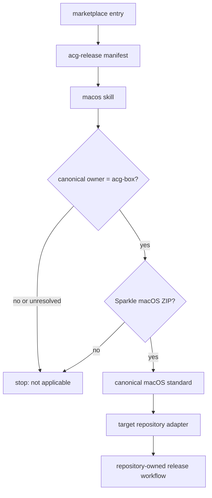

# ACG Release: macOS

## Runtime And Ownership Boundary

`plugins/acg-release/` is the complete installed runtime for ACG Box organization
release standards. It currently contains one `macos` skill, its invocation metadata,
and one canonical Sparkle ZIP release standard. It has no executable, hook, app, MCP
server, credential, network client, template, or writable state.

The plugin is extensible by release type, but only after a real release type has an
independent owner contract and evidence. Do not add empty skills, compatibility
aliases, or a generic root standard. The only current public invocation is
`$acg-release:macos`.

The installed plugin guides repository work. GitHub Actions runs only the target
repository's checked-in adapter and never loads the plugin.

## Applicability Gate

The `macos` skill resolves the target repository's canonical GitHub owner before it
audits or changes release behavior. It continues only for `acg-box/*`. A repository
outside `acg-box` is not applicable: the skill must not audit it toward adoption,
change it, operate or verify its release under the standard, or inspect or apply the
ACG Box certificate, notary, Sparkle-key, secret, environment, or publisher topology.
An unresolved canonical owner is an applicability gap, not permission to assume
membership.

This flow keeps plugin discovery, organization applicability, distribution scope,
target identity, and executable release work as separate owners. The skill loads
the detailed standard only after both applicability gates pass.

## Release Policy And Adapter

The current skill supports one regular Sparkle-enabled macOS app in a GitHub
Release ZIP. Production requires Developer ID Application signing, Hardened Runtime,
secure timestamps, Apple notarization, app stapling, strict code-signature checks,
Gatekeeper acceptance, a final post-stapling ZIP, Sparkle signature and appcast,
checksum, and draft-first GitHub publication. An Apple Development, Personal Team,
timestamp-free, unnotarized, or Open Anyway path is migration drift.

The plugin contains no Apple Team ID, certificate suffix, product identity, or
Sparkle public key. Each applicable target repository owns its paid Team ID,
expected Developer ID identity selector, app and bundle identity, versions, assets,
feeds, entitlements, Sparkle pin and public key, build commands, and smoke tests.

The skill does not support DMG, PKG, Mac App Store, bare-app, non-Sparkle, or
multi-product distribution. A future release type needs a separate skill only when
its owner contract exists.

## Release And Trust Flow

One immutable annotated stable tag binds the source. The workflow runs Linux source
validation, then macOS native test, build, signing, notarization, stapling, and
packaging, then a protected Linux publisher. The notarization upload ZIP is temporary
and never public. Apple must return an `Accepted` result and log before the app is
stapled. Only then does the workflow create the final ZIP and bind its exact bytes to
the Sparkle appcast signature and checksum.

The publisher uses a secret-free protected `release` environment and the ephemeral
workflow token with `contents: write`; other jobs default to `contents: read`.
Publication is draft-first and non-idempotent. Final acceptance requires public
metadata and downloaded-byte verification.

Shared Developer ID and team App Store Connect API-key material uses unambiguous
organization-secret names. Conformance requires effective target access and no
lower-scope shadowing. Organization visibility `all` is allowed, while a tighter
`selected` scope is also conforming when it grants the repository access. Each
application keeps its own Sparkle private key and checks in its public key.

Apple certificate creation or rotation, Sparkle-key rotation, secret mutation,
repository writes, tag push, environment approval, public Release mutation, and app
installation remain separate authorization boundaries. The release contract never
rotates the Developer ID certificate and Sparkle trust key in the same update.

## Public-Surface Change Recipe

A behavior change starts in `plugins/acg-release/skills/macos/SKILL.md` or its
canonical standard. Keep these surfaces synchronized:

- `.agents/plugins/marketplace.json` discovers `acg-release` at
  `./plugins/acg-release`.
- `plugins/acg-release/.codex-plugin/plugin.json` owns the organization scope,
  plugin metadata, and `./skills/` entrypoint.
- `plugins/acg-release/skills/macos/agents/openai.yaml` owns the invocation label
  and default prompt.
- `VERSION` and every plugin manifest use the same repository release version.
- `PRIVACY.md` owns the shared instruction-only privacy boundary.

There is no generated, bundled, or published mirror in this repository. Validate
the internal skill and marketplace-resolved plugin boundary separately. Do not add
a generic workflow, signing script, or future skill until evidence gives it one
stable interface and validation owner.

## Validation

Run the Plugin Creator validator, Skill Creator validator, Plugin Eval, and
`cargo make check` when this plugin changes. Review the physical runtime file set:
only the manifest, `macos` skill, invocation metadata, and canonical reference
belong in the plugin.

Forward tests must show three routing outcomes: an applicable legacy `acg-box`
Sparkle ZIP workflow is migration drift; an applicable Developer ID-notarized
fixture is preserved; and an outside-owner repository or a DMG, PKG, or non-Sparkle
request stops without adoption guidance or ACG Box topology.

These checks prove checked-in guidance and installability only. They do not prove a
usable local Developer ID identity, notary credentials, hosted runner, protected
environment, GitHub publication, public bytes, Gatekeeper behavior, or installed
app.

## Ownership Relationships

The [marketplace entry](../.agents/plugins/marketplace.json) discovers this plugin;
the [operations guide](operations.md) validates its installable boundary. The
[canonical macOS standard](../plugins/acg-release/skills/macos/references/standard.md)
is the release authority, while this page explains repository structure and change
impact.
