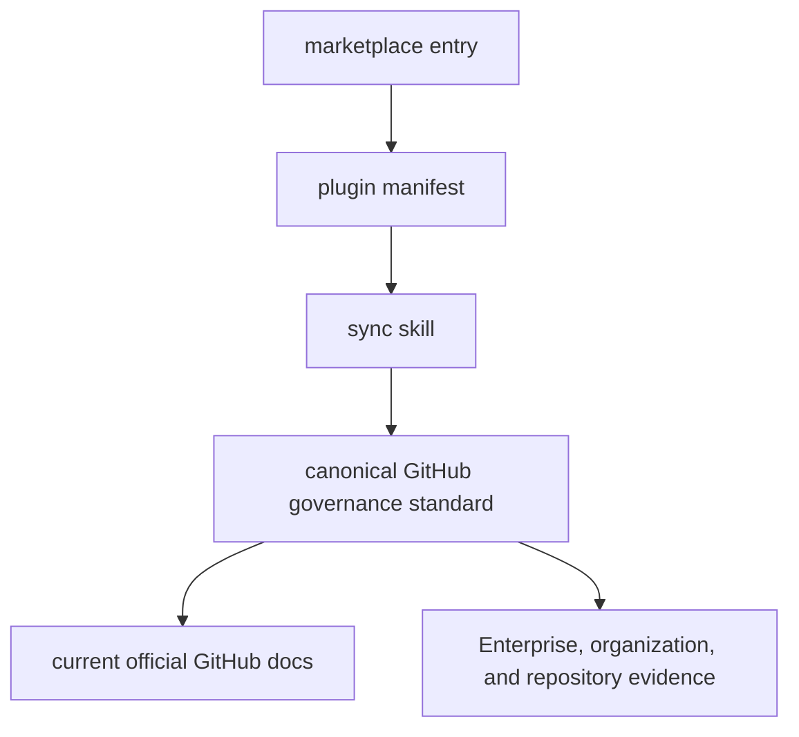

# GitHub Settings

## Runtime Boundary

`plugins/gh-settings/` is the complete installed runtime. It contains one `sync`
skill, invocation metadata, and one canonical GitHub governance standard. It has no
executable, hook, app, MCP server, credential, network client, or writable state.

The canonical standard owns operating-mode selection, target binding, central-first
classification, exact drift preview, public and private security baselines, mutation
authority, paid-product and automatic dependency submission billing gates, ruleset
migration or retirement safety, UI fallback, and authoritative readback. It
distinguishes an attached or enforced parent configuration from an unattached
catalog entry. Automatic dependency submission is a separate GitHub Actions workload,
not a Dependabot runner setting: supported manifests, Actions availability, runner
choice, and billing must be checked independently. Do not copy these rules into
OpenWiki.

## Ownership And Modes

The plugin owns GitHub governance audit and explicitly authorized reconciliation.
Organization-wide mode is central-first: it selects Enterprise enforcement,
organization enforcement, a central default, or a true repository residual in that
order. When the selected profile requires zero repository-owned rulesets, a nonzero
count on any repository fails acceptance.

Repository-scoped mode binds one exact repository. It audits parent rulesets,
defaults, policies, and security configurations but keeps all parent state
read-only. A request for one repository never authorizes organization or Enterprise
mutation.

The merge-commit-only baseline keeps the three repository merge toggles as residual
state and uses a parent pull-request rule where GitHub supports central allowed-method
enforcement. The standard requires a complete conflict check for linear-history
rules before activation.

For security baselines, automatic dependency submission gets its own preview and
readback row. Enable it only after dependency graph, GitHub Actions, supported
ecosystem, runner, and billing evidence is bound; prefer free Dependabot graph jobs
where they take precedence. Private or internal repositories require explicit
acceptance of Actions usage and possible billing.

A local ruleset in a zero-local profile is either migrated with equivalent parent
readback or explicitly retired after the user accepts the protection delta. The
workflow does not invent a team, role, app, or preservation adapter for semantics
that the approved profile says to remove.

For stale previews or uncertain writes, use the canonical
[reconciliation rules](../plugins/gh-settings/skills/sync/references/standard.md#reconciliation).
That section owns bounded readback and the conditions for resuming writes.

The public invocation is `$gh-settings:sync`.

## Public-Surface Change Recipe

A behavior change starts in `skills/sync/SKILL.md` or the canonical standard. Keep
these surfaces synchronized:

- `.agents/plugins/marketplace.json` owns discovery at `./plugins/gh-settings`.
- `.codex-plugin/plugin.json` owns plugin metadata and the `./skills/` entrypoint.
- `agents/openai.yaml` owns the invocation label and default prompt.
- `VERSION` and every plugin manifest use the same repository release version.
- `PRIVACY.md` owns the shared instruction-only privacy boundary.

GitHub APIs, UI controls, plans, and billing boundaries can change. The runtime
standard therefore requires current official documentation before live work instead
of treating a checked-in endpoint example as permanent authority.

## Validation

Run the Plugin Creator validator, the Skill Creator validator, and
`cargo make check`. Review the physical runtime file set: only the manifest, skill,
invocation metadata, and canonical reference belong in the plugin. Run Plugin Eval
when available.

When installation is in scope, install after repository checks and verify pickup in
a fresh Codex task. Installation does not prove that the task that performed the
install loaded the new runtime.
