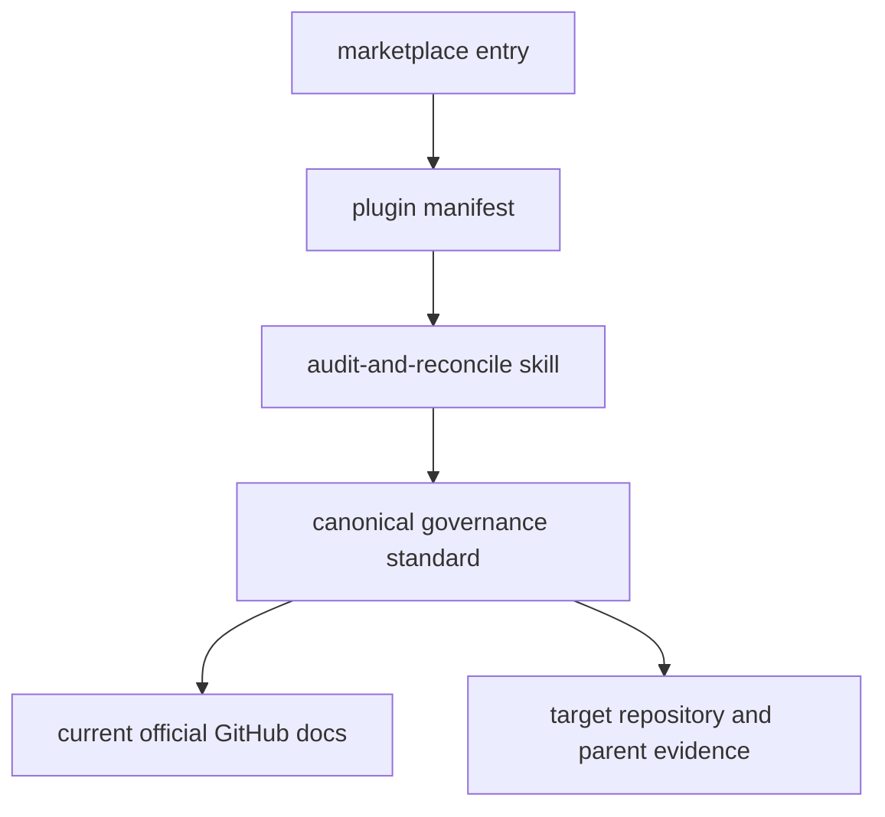

# GitHub Repository Governance

## Runtime Boundary

`plugins/github-repo-governance/` is the complete installed runtime. It contains one
`audit-and-reconcile` skill, invocation metadata, and one canonical governance
standard. It has no executable, hook, app, MCP server, credential, network client,
or writable state.

The canonical standard owns target binding, parent-scope classification, the exact
drift preview, mutation authority, private-repository billing gates, ruleset safety,
UI fallback, and authoritative readback. Do not copy these rules into OpenWiki.

## Ownership And Trigger

The plugin owns GitHub settings audit and explicitly authorized reconciliation. It
is independent from [Quality Gate Architecture](quality-gates.md), which owns
repository validation architecture; both are discovered and validated through the
shared repository operations boundary. The public invocation is
`$github-repo-governance:audit-and-reconcile`.

Repository state is not source authority for organization or enterprise state. The
skill audits parent rulesets and security configurations read-only and uses
repository-level equivalents only when current GitHub behavior supports them.

## Public-Surface Change Recipe

A behavior change starts in `skills/audit-and-reconcile/SKILL.md` or its canonical
standard. Keep these surfaces synchronized:

- `.agents/plugins/marketplace.json` owns discovery at
  `./plugins/github-repo-governance`.
- `.codex-plugin/plugin.json` owns plugin metadata and the `./skills/` entrypoint.
- `agents/openai.yaml` owns the invocation label and default prompt.
- `VERSION` and every plugin manifest use the same repository release version.
- `PRIVACY.md` owns the shared instruction-only privacy boundary.

GitHub APIs, UI controls, plans, and billing boundaries can change. The runtime
standard therefore requires current official documentation before live work instead
of treating a checked-in endpoint example as permanent authority.

## Validation

Run the Plugin Creator validator, the Skill Creator validator, and `makers check`.
Review the physical runtime file set: only the manifest, skill, invocation metadata,
and canonical reference belong in the plugin. Run Plugin Eval when available.

When installation is in scope, install after repository checks and verify pickup in a
fresh Codex task. Installation does not prove that the task that performed the
install loaded the new runtime.
