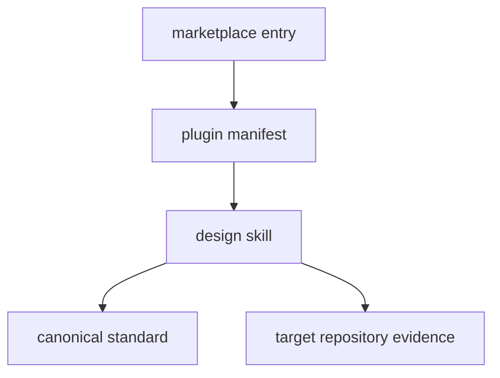

# Quality Gate Architecture

## Runtime Boundary

`plugins/quality-gates/` is the complete installed runtime. The plugin manifest
[`plugin.json`](../plugins/quality-gates/.codex-plugin/plugin.json) publishes version,
metadata, privacy policy, capabilities, and the `./skills/` entrypoint. That entrypoint
contains one `design` skill, its `agents/openai.yaml` invocation metadata, and one
canonical reference at `references/standard.md`.

The skill is instruction-only: there is no hook, executable, app, MCP server,
credential, network client, or writable state. The skill's `design` procedure audits
existing tasks and workflows, preserves distinct risk evidence, and chooses between
simple aggregation and affected-owner selection. The reference standard owns the
rules; do not copy those rules into OpenWiki.

This plugin shares the repository's install and validation boundary with [GitHub
Repository Governance](github-repo-governance.md), but the two skills own independent
standards and invocation surfaces.

This diagram shows the install and runtime-guidance ownership chain.

## Public-Surface Change Recipe

A behavior change starts in `skills/design/SKILL.md` or the canonical reference. A
metadata or invocation change may also require `agents/openai.yaml` and
`.codex-plugin/plugin.json`. A public installability change must keep all of these
surfaces synchronized:

- `.agents/plugins/marketplace.json` owns marketplace discovery and the local source
  path `./plugins/quality-gates`.
- `.codex-plugin/plugin.json` owns the plugin name, version, skill directory, public
  prompt, capabilities, and policy URLs.
- `skills/design/SKILL.md` and `skills/design/agents/openai.yaml` own skill behavior
  and invocation metadata.
- `VERSION` must match the plugin manifest for an explicit release.
- `PRIVACY.md` remains the repository-owned policy named by `privacyPolicyURL`.

The consumer import/invocation surface is `$quality-gates:design`; validate both the
internal skill structure and the installed plugin boundary. Do not hand-edit derived
artifacts because no generated or bundled mirror exists in this repository.

## Quality Gate Model

The canonical standard exposes three levels: `check-fast` for cheap deterministic
feedback, `check` for changed-owner or explicit-owner validation, and `verify` for
complete integration or release evidence. It retains independent platform, safety,
atomicity, rollback, migration, artifact, security, and runtime-boundary contracts;
it does not authorize deployment or publication.

The current repository deliberately uses a simpler implementation: `makers check`
parses both JSON manifests and runs TOML formatting checks. It has one small owner,
so it does not need a changed-scope selector or a separate `verify` task. This is an
application of the standard's single-owner rule, not a missing feature.

## Change Navigation And Tests

Consult this page when changing plugin metadata, prompts, skill structure, or the
quality-gate standard. Run the Plugin Creator validator for manifest and component
paths, and the Skill Creator validator for skill metadata and structure. Run
`makers check` after any repository or manifest change. A consumer-facing smoke test
is the validator invocation from [Install And Validation](operations.md), followed by
starting a fresh Codex task and invoking `$quality-gates:design` when installation
behavior itself changed.

Do not add a second skill, selector, test framework, or application unless a second
independent standard, executable runtime, checked-in evaluation, or release artifact
creates a real owner and contract.

## Ownership Relationships

The [marketplace entry](../.agents/plugins/marketplace.json) discovers this plugin;
the [operations guide](operations.md) validates its installable boundary. The
[canonical standard](../plugins/quality-gates/skills/design/references/standard.md)
is the behavior authority, while this page explains repository structure and change
impact.
